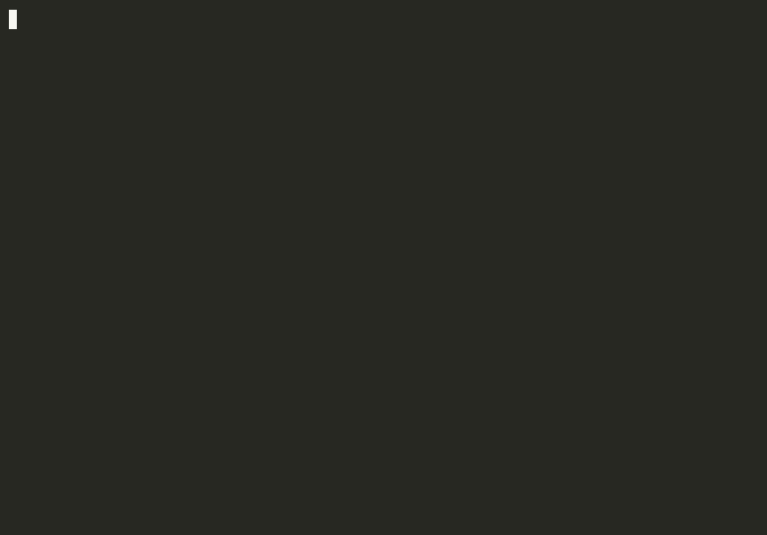
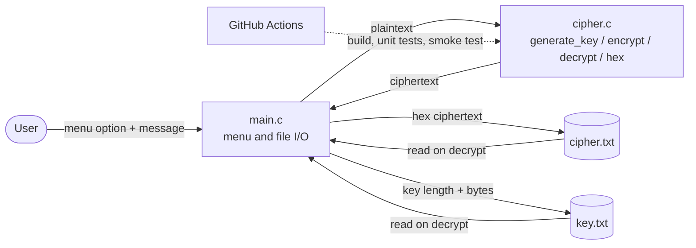

# 🔐 C Vigenère Cipher

[](https://github.com/rafauto/c-vigenere-cipher/actions/workflows/ci.yml)


A command-line program in C that encrypts a message with a **randomly generated key**
(a polyalphabetic, Vigenère-style cipher) and decrypts it back, saving both to text files.

Built as a university project (PjBL-2, *Imperative Programming*) and later revisited:
the repository keeps the **original submission** next to a **revised version** with tests and CI.

[](https://codespaces.new/rafauto/c-vigenere-cipher?quickstart=1)



> **Try it in your browser, no install needed:** click *Open in GitHub Codespaces* above
> (free with a GitHub account). The app compiles automatically; when the terminal is ready,
> type `./cipher`.

## Why I built this

The goal of the course project was to practice the fundamentals of imperative programming —
arrays, pointers, dynamic memory, file I/O and modular functions — through a problem that is
easy to verify: if the decrypted text matches what you typed, the logic is right.

Coming back to it later was a chance to apply what I learned since: finding the edge cases
that broke the first version, separating logic from I/O, and adding automated tests.

## Features

- Random key with **3 to 7 bytes**, regenerated for every message
- Each character is shifted by the key byte at the same position; the key repeats over the message
- Encrypted message saved to `cipher.txt` (as hex) and key saved to `key.txt`
- Interactive menu: encrypt, decrypt the last message, or quit
- Handles messages with spaces and up to 1,000 characters

## Example output

```text
Choose an option: 1
Type the message to encrypt (up to 1000 characters): Meet me at the library at 7pm
Encrypted: c022e13e932ae1ead4319c3edb229c36dc1fee2be5369c2be7ddb33ae0
Saved to cipher.txt and key.txt.

Choose an option: 2
Decrypted: Meet me at the library at 7pm
```

`key.txt` for this run held a 4-byte key: `115 189 124 202`.

## How it works



The user picks an option in the menu (`main.c`). To encrypt, a random key is generated and
each byte becomes `(byte + key[i % key_length]) mod 256`; to decrypt, the key is subtracted.
All cipher logic lives in `cipher.c` with no I/O, so it can be unit tested in isolation.

### What changed from the original version

| Issue in the original (`original/`) | Fix in the revised version (`src/`) |
| --- | --- |
| Used `gets()`, which can overflow the buffer | `fgets()` with a size limit |
| Decryption buffer held only 30 characters | Same 1,000-character limit for both directions |
| `fscanf("%s")` stopped at the first space in the ciphertext | Ciphertext stored as hex, so any byte is safe |
| Shifted characters could overflow `char` or become `\0` | Arithmetic on `unsigned char`, modulo 256 |
| No checks when files were missing | Clear messages when there is no key or message yet |
| Menu restarted through recursive calls | Simple loop; every opened file is closed |
| Missing prototypes; did not compile on modern strict compilers | Compiles with `-std=c11 -Wall -Wextra -Wpedantic -Werror` |

## Project structure

```text
c-vigenere-cipher/
├── original/cripto_descrito.c   # Original course submission (Portuguese, unchanged)
├── src/
│   ├── cipher.h / cipher.c      # Pure cipher functions
│   └── main.c                   # Interactive menu and file handling
├── tests/test_cipher.c          # Unit tests (no external framework)
├── .github/workflows/ci.yml     # Build + tests on gcc and clang
├── .devcontainer/               # Ready-to-run environment for GitHub Codespaces
├── docs/screenshots/demo.gif    # Terminal demo used in this README
├── Makefile
├── CONTRIBUTING.md
└── LICENSE
```

## Getting started

The quickest way is the **Open in GitHub Codespaces** button at the top. To run it locally
you need a C compiler (`gcc` or `clang`) and `make`.

```bash
git clone https://github.com/rafauto/c-vigenere-cipher.git
cd c-vigenere-cipher
make
./cipher
```

On Windows, use WSL or MinGW, or compile directly:
`gcc -std=c11 -o cipher src/main.c src/cipher.c`.

To run the original course version: `make original && ./cipher_original`.

## Running the tests

```bash
make test    # unit tests for the cipher functions
make smoke   # encrypts and decrypts a message through the menu, end to end
```

## Limitations

This is an **educational project, not secure cryptography**. Vigenère-style ciphers are
broken by frequency analysis, the key comes from `rand()` (not a cryptographic random
source), and the key is stored in plain text next to the message. Do not use it to protect
real data.

## Contributing

See [CONTRIBUTING.md](CONTRIBUTING.md).

## License

[MIT](LICENSE)

## Authors

Developed by **Rafaela Uto**, **Andréa Kiew Kozicki** and **Beatriz Tozzi Ferraz**
for the *Imperative Programming* course (PjBL-2). Revised version by Rafaela Uto.

- GitHub: [@rafauto](https://github.com/rafauto)
